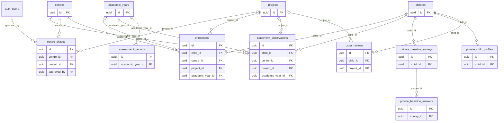
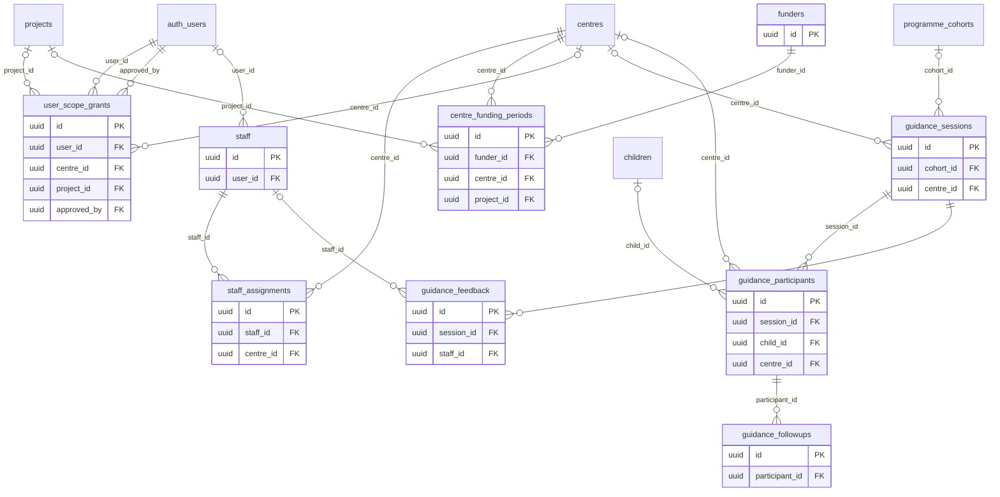
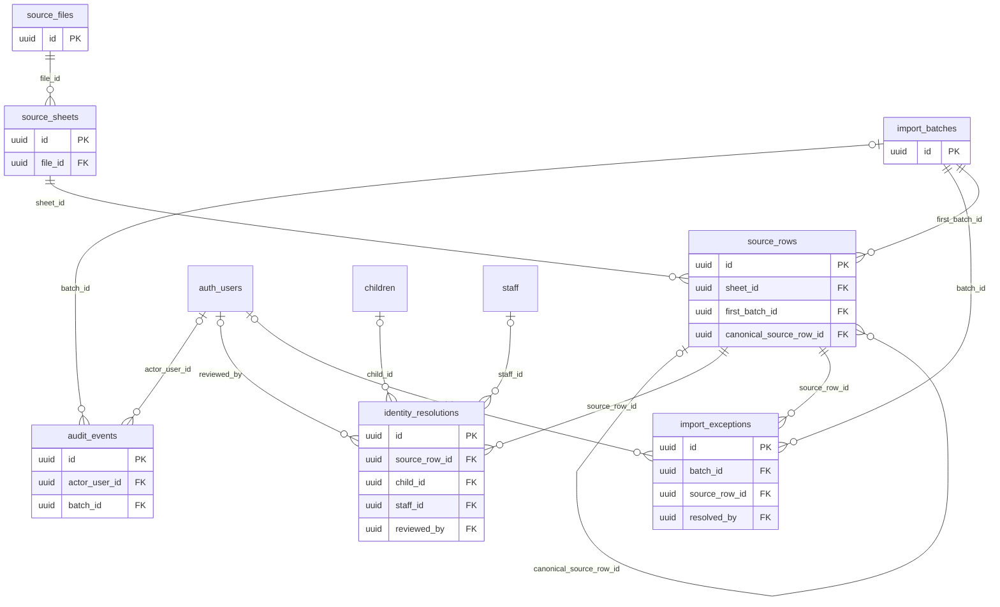

# Proposed ER diagrams

Read with DATABASE-DATA-DICTIONARY.md. These are proposed relationships, not deployed tables or approved policies. Source-backed observations, future frontend extensions and migration infrastructure have different approval gates. An FK permits many referencing records unless a unique constraint in the dictionary makes it one-to-one. Nullable FK means optional parent association. auth.users is managed by Supabase, not created by this design.

## Identity, references and historical placement

## Attendance, learning and programme operations

```mermaid
erDiagram
    attendance_codes {
        uuid id PK
    }
    cac_sessions {
        uuid id PK
        uuid centre_id FK
    }
    attendance_records {
        uuid id PK
        uuid child_id FK
        uuid centre_id FK
        uuid code_id FK
        uuid enrolment_id FK
        uuid session_id FK
    }
    assessment_definitions {
        uuid id PK
        uuid project_id FK
        uuid period_id FK
    }
    assessment_batches {
        uuid id PK
        uuid definition_id FK
        uuid centre_id FK
    }
    assessment_results {
        uuid id PK
        uuid child_id FK
        uuid definition_id FK
        uuid centre_id FK
        uuid batch_id FK
    }
    monthly_activity_returns {
        uuid id PK
        uuid child_id FK
        uuid project_id FK
        uuid centre_id FK
    }
    monthly_activity_responses {
        uuid id PK
        uuid return_id FK
        uuid activity_event_id FK
    }
    activity_events {
        uuid id PK
        uuid project_id FK
        uuid centre_id FK
    }
    activity_participation {
        uuid id PK
        uuid event_id FK
        uuid child_id FK
        uuid eligibility_enrolment_id FK
    }
    centre_visits {
        uuid id PK
        uuid staff_id FK
        uuid centre_id FK
    }
    programme_cohorts {
        uuid id PK
        uuid academic_year_id FK
    }
    cohort_memberships {
        uuid id PK
        uuid cohort_id FK
        uuid child_id FK
        uuid project_id FK
        uuid centre_id FK
    }
    morarji_outcomes {
        uuid id PK
        uuid membership_id FK
    }
    followup_actions {
        uuid id PK
        uuid child_id FK
        uuid centre_id FK
        uuid membership_id FK
    }
    academic_years |o--o{ programme_cohorts : "academic_year_id"
    activity_events |o--o{ monthly_activity_responses : "activity_event_id"
    activity_events ||--o{ activity_participation : "event_id"
    assessment_batches |o--o{ assessment_results : "batch_id"
    assessment_definitions ||--o{ assessment_batches : "definition_id"
    assessment_definitions ||--o{ assessment_results : "definition_id"
    assessment_periods ||--o{ assessment_definitions : "period_id"
    attendance_codes ||--o{ attendance_records : "code_id"
    cac_sessions |o--o{ attendance_records : "session_id"
    centres |o--o{ assessment_batches : "centre_id"
    centres |o--o{ cohort_memberships : "centre_id"
    centres |o--o{ followup_actions : "centre_id"
    centres |o--o{ monthly_activity_returns : "centre_id"
    centres ||--o{ activity_events : "centre_id"
    centres ||--o{ assessment_results : "centre_id"
    centres ||--o{ attendance_records : "centre_id"
    centres ||--o{ cac_sessions : "centre_id"
    centres ||--o{ centre_visits : "centre_id"
    children ||--o{ activity_participation : "child_id"
    children ||--o{ assessment_results : "child_id"
    children ||--o{ attendance_records : "child_id"
    children ||--o{ cohort_memberships : "child_id"
    children ||--o{ followup_actions : "child_id"
    children ||--o{ monthly_activity_returns : "child_id"
    cohort_memberships |o--o{ followup_actions : "membership_id"
    cohort_memberships ||--o{ morarji_outcomes : "membership_id"
    enrolments |o--o{ activity_participation : "eligibility_enrolment_id"
    enrolments |o--o{ attendance_records : "enrolment_id"
    monthly_activity_returns ||--o{ monthly_activity_responses : "return_id"
    programme_cohorts ||--o{ cohort_memberships : "cohort_id"
    projects |o--o{ activity_events : "project_id"
    projects |o--o{ cohort_memberships : "project_id"
    projects ||--o{ assessment_definitions : "project_id"
    projects ||--o{ monthly_activity_returns : "project_id"
    staff ||--o{ centre_visits : "staff_id"
```

## Future guidance/funding and staff access

## Migration provenance and audit

## Cardinality qualifications

- children -> private_child_profiles is zero-or-one current private profile, enforced by unique child_id (the overview FK edge alone does not show uniqueness).
- cohort_memberships -> morarji_outcomes is zero-or-one outcome set, enforced by unique membership_id.
- monthly_activity_returns -> monthly_activity_responses is up to four slot rows with unique return/slot and slot bound 1-4; missing/NULL stays unknown.
- activity_events -> activity_participation has one row per distinct event/child after approval, not one participation per month.
- children -> enrolments, placement observations, roster reviews, assessments, cohort memberships and follow-up actions are one-to-many; they must not overwrite cross-year/history data.
- academic_years -> assessment_periods -> assessment_definitions -> results separates quarter/year and paper-scale revisions. F1-F4 mapping remains a decision, not an ERD equivalence.
- source_files -> source_sheets -> source_rows is immutable snapshot lineage; canonical imported facts reference source_rows through origin_row_id plus source cell locators (the shared origin relationship is specified in the dictionary rather than repeated on every diagram).
- identity_resolutions targets a child or staff person, never both for an accepted resolution; ambiguity remains a staging decision, not a forced match.
- audit_events entity_id is an intentional durable audit locator, not an unmodeled business FK. No FK cascade may erase historical audit evidence.

All optional future guidance/funding relations are proposals. No source supports converting project labels directly into funder accounts or inferring programme admission/award outcomes.
