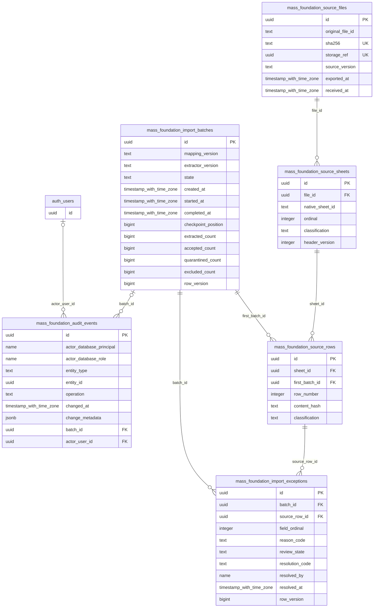
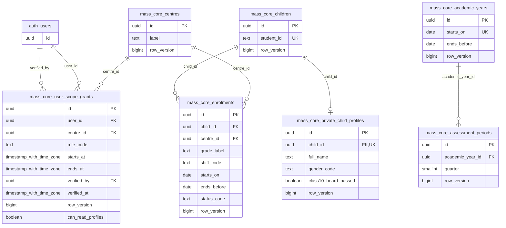
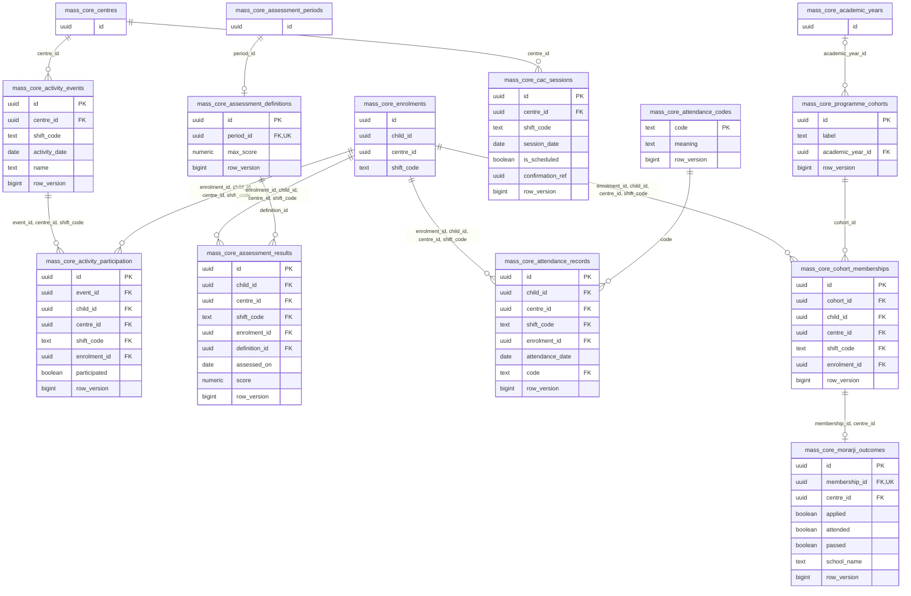

# Implemented entity–relationship diagrams

Phase 4 migration 016, 28 October 2026. **23 local relations, 16 migrations, 016 not hosted-applied.** Generated from the same isolated PostgreSQL catalog as the [dictionary](DATABASE-DATA-DICTIONARY.md) and [machine inventory](DATABASE-SCHEMA-INVENTORY.json). Earlier proposed ERDs remain in [the preserved Phase 2E snapshot](DATABASE-PROPOSED-ERD-PHASE-2E.md).

Entity IDs use `mass_core_` / `mass_foundation_` instead of schema dots for Mermaid compatibility. Every column of each owning-domain relation is shown once; referenced parents repeat as key-only stubs. `auth_users` is the existing managed `auth.users` dependency, not a created table. Optional parent associations reflect FK nullability; child zero-or-one reflects FK columns containing a UNIQUE/PK. Composite keys/NULL behavior and runtime temporal checks are specified by the dictionary and migrations.

## Foundation and managed Auth

## Core identity, access and academic references

## Attendance, assessments, activities and Morarji

## Relationships that are deliberately absent

No person/name join, polymorphic audit business FK, historical source-slot/event bridge, automatic year/quarter alias or derived staff/funder relationship is implied. Audit entity_id is a durable locator, while actor_user_id and batch_id are real FKs. No unimplemented proposed relation is drawn as deployed. All actual FK edges, including Auth and composite contextual keys, appear above.
