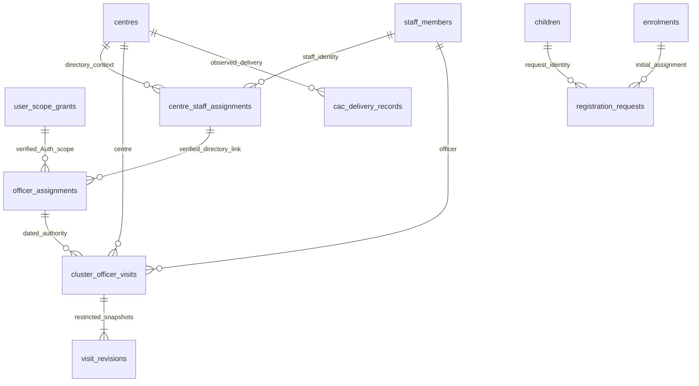

# Additive schema, permission and privacy review

The32-table/230-column/45-FK/115-policy inventory is measured from a fresh isolated install, not hosted post-deployment evidence. Migrations001–019 and their checksums are unchanged. No new owner, administrator or application database role is created. No Auth-schema grant is added. All new relations force RLS and remain in private schemas; PostgREST exposes RPCs in mass_api only.

| Relation / addition | Columns and constraints | Access / history |
|---|---|---|
|`registration_requests`|request_id UUID PK; user_id UUID; centre_id FK centres; child_id FK children; enrolment_id FK enrolments; identifiers only|Owner-only; no direct application grant. Immutable receipts. Same request/user/centre/payload resolves existing target IDs, never a name-only match. Changed payload conflicts.|
|`officer_assignments`|UUID PK; scope_grant_id FK user_scope_grants; directory_assignment_id FK centre_staff_assignments; starts_on date; optional exclusive ends_before; verification_reference1–160 chars; explicit shift_scope=Both shifts with no default; unique grant/directory/start|Owner-only controlled provisioning. Trigger requires both linked roles to be CO and centre IDs to match. Directory names or NULL source shifts do not grant permissions. Both-shifts authority is an explicit verified operational assertion. Updates/deletion/truncate prohibited. No links installed by migration.|
|`cluster_officer_visits`|UUID request/PK; assignment FK; centre FK; officer FK staff_members; shift Morning/Evening; visit_date; status Planned/Completed; feedback and next_action each≤2000 chars; timestamps; row_version; created_by/last_updated_by|No direct Auth table access. Officer author must have current CO write capability, correct dated verified link and permitted shift. Leadership designation blocks writes. Completed requires feedback and non-future date. Identity immutable; corrections require expected version and reason. No deletion.|
|`visit_revisions`|UUID PK; visit FK; operation; previous/new JSON; actor UUID; timestamp; revision; optional correction reason≤500; unique visit/revision; UPDATE reason required|Owner-only storage; read API requires current officer scope and own authored visit. Leadership/teachers/anonymous cannot read snapshots. Immutable. Full operational feedback remains here, not in technical audit metadata.|
|`cac_delivery_records`|UUID PK; centre FK; shift; session_date; Planned/Held/Cancelled; revision; created/updated actor IDs and timestamps; unique centre/shift/date|Assigned staff writes through RPC; authorized centre reads through RLS. Explicit observations, separate from is_scheduled calendar. Future Held and confirmed-holiday conflicts rejected. No deletion.|
|`activity_events` additions|nullable category Cultural/Sports; nullable delivery_status Planned/Held/Cancelled|Existing rows remain NULL. Event context/ID/date/centre/shift immutable; approved name/category/status correction is versioned. Planned/cancelled events reject participation; cancellation cannot invalidate observed participation. No inferred catalogue or dates.|

## API contracts and review

- `require_staff_session()` validates the database role and managed Auth-derived identity. New definer RPCs do not accept forged business roles, a caller-supplied actor or a null/global centre. Accidental inherited authenticated grants to service_role are rejected. No application role receives owner membership.
- Period-based assessment reads remain invoker/RLS functions. NULL exact dates qualify only through approved quarter overlap. Corrections use `IS DISTINCT FROM` for context, including NULL, and serialize creation by child/definition.
- Attendance/assessment/participation batches are bounded to500 records, reject duplicate contexts and execute existing per-record authorization/validation within one transaction. Stable ordering reduces lock conflicts; failures roll back earlier successful changes. Future attendance and WO on non-Sunday are rejected.
- Registration once uses a request UUID and known returned target identifiers; no identity merge by name. Profile changes preserve child UUID, permanent student ID and episode identity. Transfers require two explicit dates and existing source/destination authority; profile change, old closure and new episode are atomic. No continuity date, shift or missing grade is invented.
- Visit APIs return aggregates to readable centres and private details/history only to the current authorized author. Official2+2 targets are full calendar-month targets with no invented proration. Officer-specific eligible centres come from dated verified links. Mixed/partial assignments need administrator evidence; no links are manufactured from source names.
- `programme_aggregate` returns only bounded, scoped counts/means/buckets, never child IDs, names, household values or profile rows. Profile-table RLS/grants are unchanged. Gender filtering is server-side for aggregate-only accounts; identifying filtered rows remain unavailable. Small-cell publication/privacy policy remains an organizational gate; no threshold is invented.
- `read_enrolment_basis` reveals only an allowed enrolment ID and minimized date-basis label. No receipt/source row, HMAC, workbook reference or import metadata is exposed. `read_record_revisions` whitelists record types and proves centre ownership; returns revision/operation/time only. Foundation owner grants core owner only the minimized audit columns under a core-only RLS policy; none are granted to Auth roles.
- SECURITY DEFINER bodies have fixed pg_catalog search paths, qualified objects, caller/scope validation and owner-limited ACLs. No ad-hoc elevated function manipulates managed Auth. Plain PostgreSQL Auth stubs are explicitly not managed Auth verification.

## Remaining policy gates

Actual account scopes, dated officer identities, private-profile capabilities, sensitive note purpose/retention, deletion/restoration, paper comparability/precision, complete calendars, historical donor attribution and advanced outcomes need their documented evidence. This release installs no accounts/role rows, imports no source records and does not resolve missing identities. Restricted snapshots are an approved visit requirement; operational retention/administration must be agreed before real staff activation.
